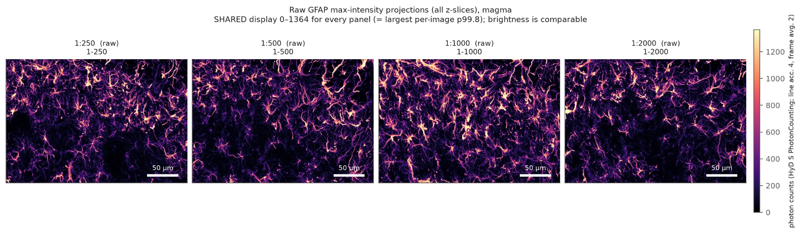
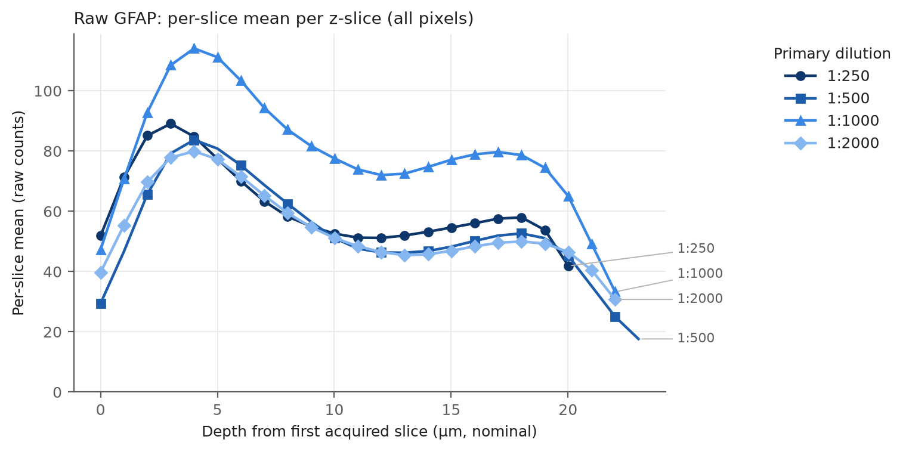
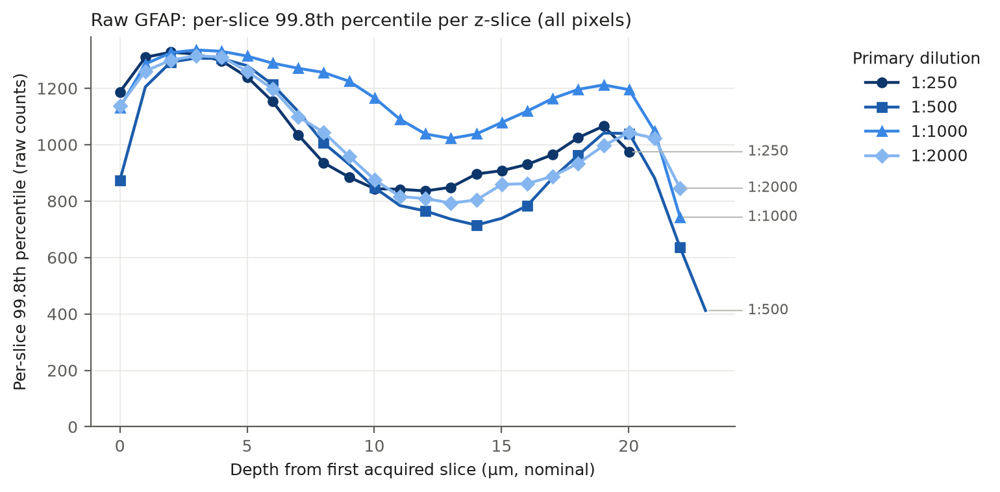
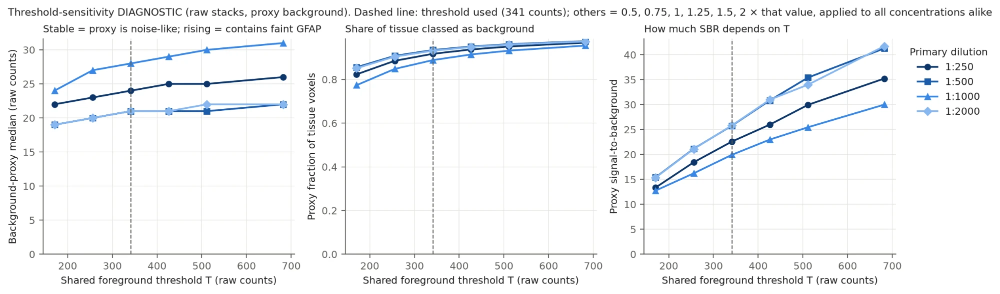
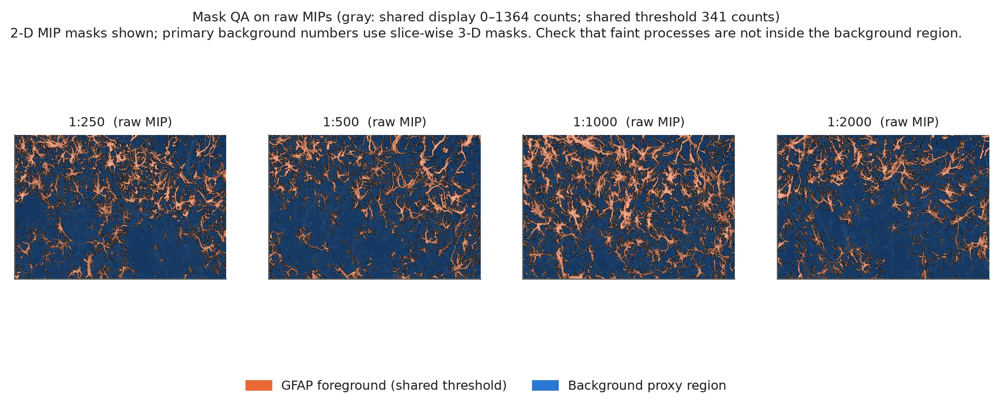
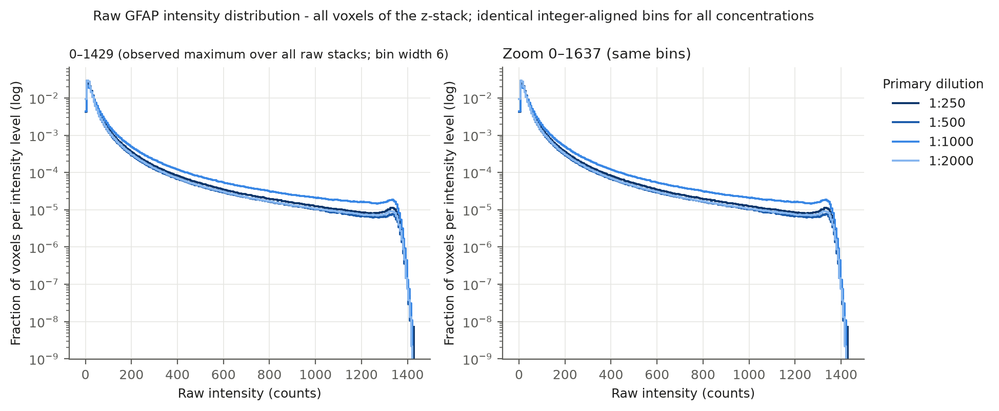
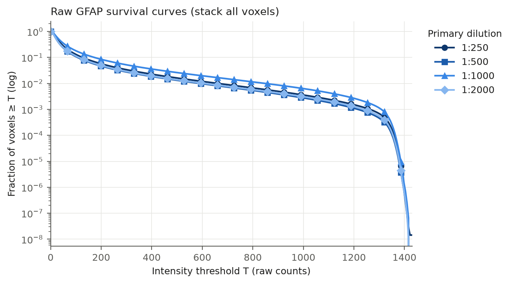

# Mouse anti-GFAP concentration curve: first quantitative report

Nov 23, 2026 · Sewon

Across an 8-fold range of primary dilution (1:250 to 1:2000), none of the measured properties of the raw AF647 GFAP signal changed with concentration: brightness, retention through the stack, background and intensity distribution were all alike. This matches Rose's visual impression, but one field per dilution and a detector ceiling in the current acquisition settings mean no optimal concentration can be named yet.

## Summary

- **No concentration effect on brightness.** Raw MIP mean was 219.5, 204.6, 288.3 and 199.4 photon counts at 1:250, 1:500, 1:1000 and 1:2000. Three of four lie within 10% of each other; 1:1000 is higher but out of order with dilution.
- **The 1:1000 difference is field content, not stain intensity.** Its intensity distribution has the same slope as the others, shifted up: more GFAP-occupied volume (4.4% vs 2.3-2.8% of voxels above threshold), not brighter structures.
- **The middle of the stack is dimmer at every dilution, equally.** Mean signal near mid-depth is about 55-63% of the near-surface peak. 1:250, 1:500 and 1:2000 overlap almost exactly at mid-depth, so more primary did not improve penetration.
- **Background is low and does not track dilution.** The background proxy is 21-28 counts, against a foreground median of about 540 counts.
- **The detector saturates softly near 1,400 counts.** All four stacks share a pile-up at 1,300-1,340 counts and a cliff at about 1,420. Maxima and p99.8 measure that ceiling, not the stain, so only means, medians and the 100-1,200-count range are used for comparison.

## Data and acquisition

All imaging settings that affect intensity were identical for the four raw images, so photon counts are comparable at the acquisition level. Only z-range, number of sections and stage position differed.

| Item | Value |
| --- | --- |
| File | Sewon_GFAP_curve.lif (2.40 GB) plus companion .lifext (0.38 GB, not used) |
| Images | 1-250, 1-500, 1-1000, 1-2000 (raw) and the same four with suffix _Lng (deconvolved, excluded) |
| Channels | 0 = DAPI (405 nm, 2%), 1 = ALEXA 647 (638 nm, 2.5%), analysed: channel 1 |
| Objective | HC PL APO CS2 20x/0.75 dry, zoom 2 |
| Pixel and field | 0.132 µm, 2200 x 1500 px (about 291 x 198 µm) |
| z | 1.0 µm steps; 21, 24, 23, 23 slices (20.0-22.3 µm, nominal) |
| Detectors | HyD S (SiPM), PhotonCounting mode, gain 2.5, offset 0 |
| Scan | Speed 400, line accumulation 4, frame average 2, pinhole 1.0 AU |
| Stage X | 66.6, 62.2, 57.8, 53.2 mm: four different sections |

The _Lng images reach 65,535 with 0.3-0.6% of voxels clipped there, consistent with deconvolution plus rescaling to the full 16-bit range. As Rose specified, they were excluded from every intensity measurement.

## Methods in brief

Each raw AF647 stack was read with its original integer values, and every statistic was computed on those unscaled photon counts. The analysis code is the gfap-conc Python pipeline, written independently of Rose's earlier script so the two can be compared. It was developed with an AI coding assistant (Claude) under Sewon's direction; see docs/SESSION_LOG.md in the repository.

1. **Max projection.** MIP = maximum over z for each pixel. Reported: mean, median and p99.8 of the MIP. p99.8 is kept as a display ceiling, never used to rescale values before comparing dilutions. Because the stacks differ in depth, MIPs over the same physical thickness were also computed.
2. **Depth.** Per-slice mean, median and p99.8, plus the ratio of a middle window to the first-acquired window (each 20% of the slices).
3. **Background (proxy).** Tissue voxels below one shared foreground threshold (341 counts, Otsu on equal samples from all four stacks) and more than 5 px from any foreground voxel. Without no-primary controls this is a proxy, not a measured autofluorescence level. The threshold was re-run at 0.5-2x as a sensitivity check.
4. **Histograms.** Exact voxel counts in identical 6-count bins (0-1,429 counts) for every dilution, plus survival curves (fraction of voxels at or above each threshold).

Safeguards: the .lif was opened read-only and verified by SHA-256; deconvolved images are blocked from every intensity function; tissue mask and z-range were reviewed on the real images and confirmed before any comparison was run.

## 1. Max-projection intensity ("average bit value")

MIP brightness did not follow dilution: an 8-fold increase in primary from 1:2000 to 1:250 raised the MIP mean by 10%, and the highest value belongs to 1:1000.

| Dilution | Slices | MIP mean (counts) | MIP median | MIP p99.8 | MIP mean, matched 20-21 slices | GFAP voxels above threshold |
| --- | --- | --- | --- | --- | --- | --- |
| 1:250 | 21 | 219.5 | 110 | 1357 | 219.5 | 2.8% |
| 1:500 | 24 | 204.6 | 100 | 1352 | 200.9 | 2.3% |
| 1:1000 | 23 | 288.3 | 157 | 1364 | 287.7 | 4.4% |
| 1:2000 | 23 | 199.4 | 98 | 1354 | 197.5 | 2.4% |

Restricting each MIP to the same physical thickness changed the means by 2% or less, so unequal stack depth does not explain the pattern. p99.8 is the same for all four within 1%. It lies inside the detector's compression band (section 4), so it cannot separate dilutions in these images. On a shared display scale the four fields look alike except that 1:1000 is densely stained across the whole field, while the others are sparser in their lower half (figure below).

*Figure 1. Raw AF647 MIPs (all slices), magma, shared display 0-1,364 photon counts for every panel. Brightness is directly comparable between panels.*

## 2. Signal through the z-stack ("how much darker is the middle?")

Every stack is brightest near both surfaces and dimmest at mid-depth, and the dip is the same at 1:250 as at 1:2000. That pattern fits antibody entering a free-floating section from both faces, but more primary did not reduce it.

| Dilution | Middle / first window, mean | Middle / first window, p99.8 | Mean: first window | Mean: middle window |
| --- | --- | --- | --- | --- |
| 1:250 | 0.73 | 0.68 | 74.3 | 54.3 |
| 1:500 | 0.81 | 0.68 | 61.0 | 49.6 |
| 1:1000 | 0.87 | 0.86 | 86.7 | 75.5 |
| 1:2000 | 0.76 | 0.67 | 64.5 | 49.2 |

Windows are 20% of each stack's slices (4-5 slices); z = 0 is the first acquired slice. Measured from the per-slice mean curve, the mid-depth minimum is about 55-63% of the near-surface peak (read from the figure, approximate). After subtracting the background proxy, specific signal at mid-depth is roughly 40-50% of the peak. The p99.8 ratios understate the dip because surface p99.8 values sit in the detector's compression band. Middle-to-last ratios are not reported: the 1:250 stack (20.0 µm against 22.0-22.3 µm) probably stops just short of the lower surface, so its last window is not comparable.

*Figure 2. Per-slice mean (raw counts) versus nominal depth from the first acquired slice. Unaffected by the detector ceiling; the primary depth measure.*

*Figure 3. Per-slice p99.8 versus depth, the measure Rose used previously. Near-surface values (about 1,300 counts) sit in the detector's compression band, which flattens the peaks and understates the dip.*

## 3. Background fluorescence

Background is low at every dilution and shows no trend with antibody amount, so there is no sign of concentration-dependent non-specific binding. These are proxy values, not measured autofluorescence.

| Dilution | Background proxy median (counts) | Within-image robust SD | Foreground median (counts) | Signal / background |
| --- | --- | --- | --- | --- |
| 1:250 | 24 | 19.3 | 542 | 22.6 |
| 1:500 | 21 | 16.3 | 541 | 25.8 |
| 1:1000 | 28 | 23.7 | 558 | 19.9 |
| 1:2000 | 21 | 17.8 | 542 | 25.8 |

The robust SD is the spread of background voxels within one image, not uncertainty between replicates. Across thresholds from 0.5x to 2x (170-682 counts) the background median moved only between 19 and 31 counts, so the estimate is stable. Its signal-to-background ratio is not: it rises 2.4-2.7-fold across that range, so these ratios should not be used to rank dilutions. The slightly higher background at 1:1000 matches its denser field: more faint processes fall below the threshold. In all four stacks the proxy has a long upper tail (tail ratio about 5), meaning it contains faint processes and out-of-focus light. Whether perfusion-related autofluorescence differs cannot be judged without no-primary controls.

*Figure 4. Threshold-sensitivity diagnostic. The same absolute threshold is applied to every dilution at each point; dashed line = threshold used (341 counts).*

*Figure 5. Mask QA: GFAP foreground (orange, shared threshold) and background-proxy region (blue) on the raw MIPs. Primary background numbers use slice-wise 3-D masks.*

## 4. Intensity distributions and the detector ceiling

Between 100 and 1,200 counts the four voxel-intensity distributions are parallel lines on a log scale: the same shape at every dilution. If more antibody made each GFAP structure brighter, the curves would stretch to the right and flatten; they do not. 1:1000 is shifted upward with the same slope, which means more GFAP-positive volume, not brighter staining.

| Dilution | Stack voxels: median (counts) | 90th percentile | 99th percentile | Maximum |
| --- | --- | --- | --- | --- |
| 1:250 | 27 | 126 | 662 | 1429 |
| 1:500 | 22 | 106 | 590 | 1421 |
| 1:1000 | 33 | 173 | 849 | 1419 |
| 1:2000 | 23 | 112 | 609 | 1418 |

Rose's thin-versus-thick-process hypothesis predicts a change in distribution shape; no such change appears across dilutions. Histogram shape alone cannot measure process thickness, so this is a null result for the hypothesis, not a morphological measurement.

**Detector ceiling.** All four stacks show a small pile-up at 1,300-1,340 counts followed by a cliff at about 1,420, and their maxima agree within 0.8% although they are different sections. A smooth biological distribution would not do this. The pattern is the expected signature of photon-counting compression of the brightest signal below an effective ceiling. There is no hard clipping: only one voxel sits at each maximum. About 0.1% of stack voxels lie in the compressed band, but it includes MIP p99.8 and the near-surface per-slice p99.8. Means, medians and the 100-1,200-count range are unaffected, and the absence of a dilution effect holds there too, so the ceiling alone does not explain the result.

*Figure 6. Voxel-intensity distribution of each whole stack, identical 6-count bins, log scale. Parallel curves from 100 to 1,200 counts; pile-up at 1,300-1,340 and cliff near 1,420 in all four.*

*Figure 7. Survival curves (fraction of stack voxels at or above each intensity). 1:250, 1:500 and 1:2000 nearly coincide; 1:1000 is shifted up; all converge at the ceiling.*

## Interpretation and confidence

The most likely reading is that this aliquot is already in excess at 1:2000 under this protocol: binding has plateaued, so diluting from 1:250 to 1:2000 changes neither per-structure brightness, penetration nor background. The one field that differs, 1:1000, differs in how much GFAP-positive tissue it contains, which points to section or region rather than concentration.

What can be said now: there is no evidence that a primary more concentrated than 1:2000 helps. 1:2000 gave equivalent results with the least antibody, but that is a tentative observation, not a recommendation. Confidence is low to moderate, because each dilution is one field from a different section, and the brightest signal is compressed by the detector. The mid-depth dip is real but is not explained by primary concentration in this range; secondary-antibody penetration, depth-dependent optics with a dry objective, or tissue structure remain open.

## Limitations

- **One field per dilution, each from a different section** (stage positions about 4.4 mm apart). Field-to-field variation cannot be separated from concentration, and no inferential statistics are possible: pixels and slices are not replicates.
- **Region comparability is unconfirmed.** All four fields share a layout (dense band at the top, sparser below), but whether they are the same part of the cord needs Rose's confirmation.
- **Soft detector saturation** near 1,400 counts makes maxima and p99.8-based metrics uninformative, including the p99.8 normalisation and depth curves used in earlier analyses.
- **Background is a proxy.** No no-primary control was available, so autofluorescence and non-specific binding cannot be measured.
- **Depth is nominal.** With a dry objective, true depth in tissue is likely larger than stage travel. The 1:250 stack is 2 µm shorter than the others.
- **Deconvolved (_Lng) images were not analysed.** They were excluded from intensity work by design; a morphology comparison against the raw images has not been done yet.

## Recommendations and questions for Rose

The next round should first bring the brightest signal below the detector ceiling, then add replicates and lower concentrations.

1. **Check detector linearity.** Image one field twice, e.g. 638 nm at 2.5% and 1.25%, or line accumulation 4 and 2. If bright and dim pixels scale by the same factor the response is linear; if bright pixels scale less, the current settings compress them. Then choose settings that keep the maximum well below about 1,400 counts.
2. **Image several fields per dilution in matched regions,** e.g. the ipsilateral and contralateral images already planned, from the same anatomical location in each section.
3. **Extend the dilution series** to 1:4000 and 1:8000 to find where signal starts to fall. That point defines the useful working range.
4. **Include no-primary controls** so background and autofluorescence can be measured rather than estimated.
5. **Compare with Emma's acquisition settings.** Her samples did change with concentration; different laser or accumulation settings could be part of the reason.

Questions:

- Are the four sections from the same region of the cord (e.g. dorsal horn, grey/white-matter boundary)?
- At these count levels, is HyD S photon counting expected to be linear in your experience?
- Did your earlier p99.8-based normalisation and depth curves use similar acquisition settings? If so they may be affected by the same ceiling.

## Provenance

All numbers come from a confirmed (reviewed) run on the unmodified .lif. Histogram and survival figures come from a re-run on the same input after a bin-range fix. No other value changed between the two runs.

| Item | Value |
| --- | --- |
| Input .lif SHA-256 | da134597fa839257395a3f5595f4c0a634910837337f518725bc278fc27041be |
| Companion .lifext SHA-256 | 534d60073c64663a78426e7efa98944217e695dc56be60deb896d9732db5e1a3 |
| Review | tissue mask none, z-range full, confirmed by Sewon; settings hash 6fd16a9c650c08a97525ff47892088c32e02a03f9756c235af9e2fdc7bd9b3cb |
| Main run | run_20261122-153413, config hash b25e7b4d1d3691adc49f4bc139ede49711a5aa6fd8ce9725c15d1ef823fa6a6c |
| Code | gfap-conc, repository sjung-research/phar599, branch claude/blissful-cori-wjn019; exact commit and package versions in each run_manifest.json |
| Software | Python 3.13, liffile 2026.11.12, numpy, scipy, scikit-image, pandas, matplotlib |

Full tables (CSV), every figure and the QC warnings are in the run folders on Sewon's laptop. Calculation definitions are in docs/methods.md of the repository.
